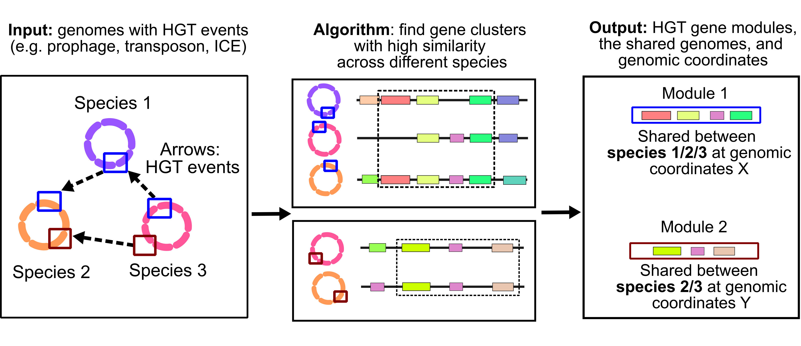

**Hogart** is a tool that finds clusters of genes, or "modules", that have been horizontally transferred within a diverse set of input genomes. For example, given a set of genomes across different species, hogart can detect shared prophages, integrative conjugative elements, or transposons between >= 2 genomes.  

<!---- The detected modules are often integrative mobile genetic elements (iMGEs) or genomic islands (GIs). This includes, e.g., prophages, integrative conjugative elements, and transposons. --->

### What can hogart do?

Hogart differs from horizontal gene transfer (HGT) detection methods that use phylogenetics and genomic island prediction tools. Instead, hogart (1) uses an all-to-all comparative method and (2) detects multi-gene transfers.

1. **Detect multi-gene transfers simultaneously in tens to thousands of genomes**. Existing methods detect HGT one gene at a time. However, multiple genes are usually transferred in one event, not just one gene. Hogart predicts **multi-gene** transfers very efficiently. 
2. **Compares all-to-all genomes and finds multi-way (i.e., not just pairwise) transfers**. Hogart outputs (1) the HGT modules shared by >= 2 genomes and (2) the loci where the modules are integrated. 
3. **Easy to use: input genomes or annotations --> HGT modules in one command**. Hogart is also easy to install, relying on minimal dependencies. 
4. **Detects small or large transfers.** Hogart can detect modules of 2 genes (e.g., transposon-like) and even ICEs and prophages of > 100 kbp. 

For more information on [how hogart works, and its limitations, see here](explanation.md).

## How do I install and run hogart?

See the left side bar for more information. See [the quick start and installation instructions](install+quickstart.md) for a quick start. 

## Changelog

See the [CHANGELOG](https://github.com/bluenote-1577/hogart/blob/main/CHANGELOG.md) for complete details.

## Citing hogart 

Jim Shaw and Heng Li. Forthcoming. 

