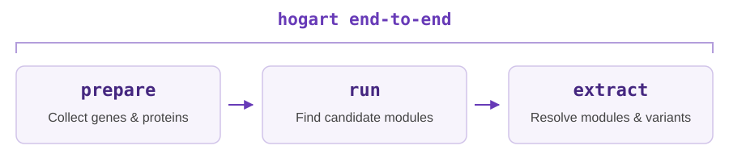

## Overview



**Example usage:**

```sh
hogart end-to-end --annotated-genomes bakta_or_prokka_genomes/*\
     -c bac120+rbp.hmm -t 30 --out-dir hogart_results
```

### Common options

| Option | Meaning |
|---|---|
| `--annotated-genomes` / `--genomes`| See [input options below](#inputs) |
| `--out-dir` | Output folder |
| `-t` | Number of threads |
| `-c bac120+rbp.hmm` | HMM file of conserved genes (e.g., ribosomal proteins) to filter out. Can be given multiple times |
| `--skip-hmms` | Don't filter conserved genes. Either `-c` or `--skip-hmms` is required |
| `--skip-failed-genomes` | Log and skip individual preparation failures for `--genomes` / `--annotated-genomes`, instead of stopping |

Run `hogart end-to-end --help` for all options.

## Inputs

Hogart takes a set of genomes (isolates or MAGs), **one genome per file**. A genome file can contain multiple contigs. Hogart finds modules shared **between** genomes, never within one.

Hogart needs a genome FASTA, a GFF, and protein sequences for every genome. Gene annotations (gene names, products) are not used by the algorithm; they only make the output easier to read. All input files can be gzipped.

### Input options

**1. Raw FASTA files (no annotation).** Hogart calls genes for you with [pyrodigal](https://pyrodigal.readthedocs.io/en/stable/).

`pyrodigal` must be installed and available in PATH for raw FASTA inputs.

```sh
hogart end-to-end --genomes genomes/*.fa -c bac120+rbp.hmm -t 30
```

**2. Annotation folders (Bakta, Prokka, or NCBI RefSeq downloads).** Point hogart at one folder per genome.

```sh
hogart end-to-end --annotated-genomes bakta/genome1 bakta/genome2 -c bac120+rbp.hmm -t 30
```

Each folder must contain a genome FASTA (`.fna`), a GFF (`.gff` or `.gff3`), and proteins (`.faa`). A `.ffn` file is used if present but is not required.

**3. Your own GFF + FASTA + protein files.** Give the three files for each genome **in the same order**:

```sh
hogart end-to-end \
  --gff gffs/g1.gff gffs/g2.gff \
  --gff-fna fasta/g1.fna fasta/g2.fna \
  --gff-faa proteins/g1.faa proteins/g2.faa \
  -c bac120+rbp.hmm -t 30
```

- Protein FASTA headers must match the CDS IDs in the GFF (RefSeq's extra `cds-` prefix on CDS IDs is supported).
- Genome names are taken from the folder containing each GFF (handy for NCBI downloads where every file is called `genomic.gff`). Add `--genome-id-stem` to name genomes by the GFF filename instead.

!!! note "Protein sequences are required"
    Hogart stops with an error if a genome has no matching proteins. Genes without a protein (e.g., pseudogenes) are silently skipped.

`--skip-failed-genomes` is available in both `prepare` and `end-to-end`. It skips genome-specific preparation failures and leaves those inputs out of the manifest. 

### Treating contigs as genomes 

You can also treat every contig in an assembly as its own genome, e.g., to find modules shared between organisms in a single metagenome. Use `--contigs` (raw FASTA) or `--annotated-contigs` (annotation folder):

```sh
hogart end-to-end --contigs assembly.fa --meta -c bac120+rbp.hmm -t 30
```

!!! warning "Use long or complete contigs"
    A module can only be found if it sits on a contig with its genomic context. This mode works best with long, ideally complete, contigs (e.g., from long-read assemblies). Short, fragmented contigs from short-read assemblies will give poor results.

- `--meta` runs pyrodigal in metagenome mode, which is recommended for assemblies.
- Contigs shorter than 50,000 bp (50 kb) are ignored by default. Adjust this with `--min-contig-len` in `prepare` or `end-to-end`; this applies to `--contigs` and `--annotated-contigs`.

## Running the steps separately

`end-to-end` is equivalent to running these three commands:

```sh
hogart prepare --genomes genomes/*.fa --out-dir prepare -t 30
hogart run prepare/manifest.tsv --out-dir run --conserved-hmms bac120+rbp.hmm -t 30
hogart extract run/path_regions.json --out-dir extract --conserved-hmms bac120+rbp.hmm -t 30
```

`prepare` accepts the same input options as `end-to-end` (see [Inputs](#inputs)).


### Rerunning `extract` with different settings

`extract` is fast compared to `run`. To change how modules are cleaned up or which extra files are written, you can rerun `extract` on the `run/` output instead of rerunning everything:

```sh
hogart extract \
  hogart_results/run/path_regions.json \
  --out-dir extract_v2 \
  --conserved-hmms bac120+rbp.hmm \
  --write-gene-families \
  -t 30
```

Useful options:

- `--min-frequency` (default 0.65): minimum ANI-weighted frequency across assigned regions at the ends of a module. Lower it to get longer modules; raise it to get stricter, shorter modules. The graph first filters nodes below 0.33 frequency, and requires support from at least two raw regions when more than four regions are assigned.
- `--write-gene-families`: write every version of each module gene (see [Output formats](outputs.md#per-module-folders)).
- `--no-genbank`: disable the default per-locus GenBank exports.
- `--path-id N`: only process candidate `N` (the ID in `run/paths.tsv`). Repeat to select several.

!!! tip
    Keep `path_regions.json` in the `run/` folder; `extract` also uses the `clusters.tsv` next to it. Supply `--conserved-hmms` again to retain post-extraction screening; the HMM databases are not inferred from the input JSON. Use a new `--out-dir` so your original results are not overwritten. The shortcuts in `hogart_results/` still point to the original `extract/`.
